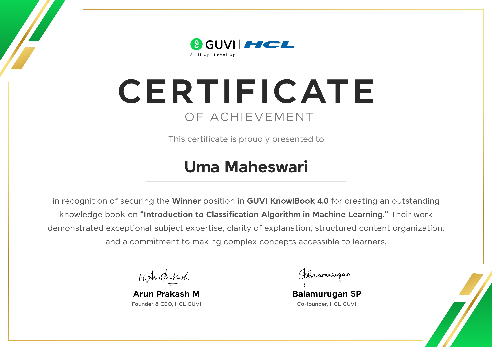
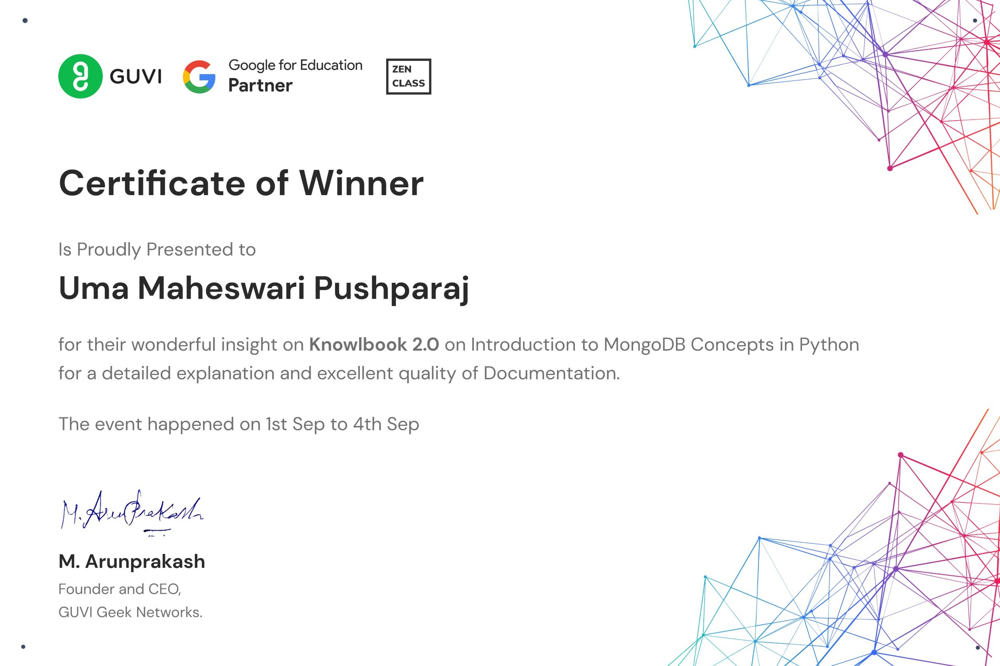

# KnowlBook: Prize-Winning Learning Notebooks

Two beginner-friendly learning notebooks I wrote for **GUVI's KnowlBook contests**. Both were selected as **winners** for their clarity, structure and quality of documentation.

| Contest | Topic | Result |
|---|---|---|
| **GUVI KnowlBook 4.0** (Oct 2023) | Introduction to Classification Algorithms in Machine Learning | **Winner** |
| **GUVI KnowlBook 2.0** (Sep 2023) | Python – Advanced | **Winner** |

The aim of a KnowlBook is to explain a topic so that a beginner can follow it on their own. I used short stories, simple language and small runnable examples so each idea is easy to picture before the code.

---

## 1. Introduction to Classification Algorithms in ML · KnowlBook 4.0

[`Classification_Algorithms_KnowlBook.ipynb`](knowlbook-4.0-classification-ml/Classification_Algorithms_KnowlBook.ipynb)

A guided tour of classification, told through a running story about a learner named Darrah.

- **Basics:** binary vs multi-class classification
- **Linear models:** Logistic Regression, Support Vector Machines
- **Non-linear models:** K-Nearest Neighbours, Kernel SVM (linear, polynomial, RBF, sigmoid and custom kernels), Naive Bayes, Decision Tree, Random Forest
- **Evaluation:** log loss, confusion matrix, AUC-ROC curve
- **Datasets:** scikit-learn's Wine and Breast Cancer datasets
- "When to use" notes for each algorithm, plus a final summary

## 2. Python – Advanced · KnowlBook 2.0

[`Python_Advanced_KnowlBook.ipynb`](knowlbook-2.0-python-advanced/Python_Advanced_KnowlBook.ipynb) · [PDF version](knowlbook-2.0-python-advanced/Python_Advanced_KnowlBook.pdf)

Advanced Python topics, each with a plain explanation and a small example:

- Functions as arguments, lambda functions, `map` and `filter`
- List comprehensions and iterators (`iter`, `zip`, `enumerate`)
- File handling (read, write, append, create, `with` statement)
- Regular expressions (metacharacters, character classes, quantifiers, anchors, groups)
- Pickling and JSON (serialisation and deserialisation)
- `datetime` (formatting, parsing, time zones, arithmetic) and the `calendar` module

---

## Certificates

  
  

---

**Uma Maheswari Pushparaj** · Data Analyst & Data Analytics Trainer · [LinkedIn](https://www.linkedin.com/in/uma-maheswari30/)
